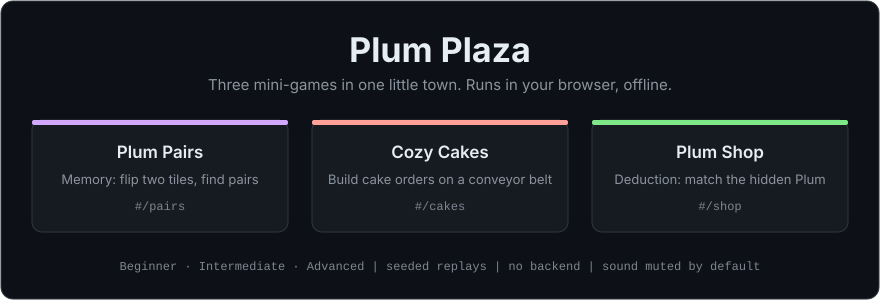
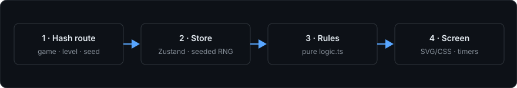

<div align="center">

# Plum Plaza

### Three calm puzzle games in one little town, right in your browser.

**Free, offline browser game collection built with TypeScript and React.** A memory tile-matching game, a conveyor-belt cake-order game and a colour deduction puzzle, each with three difficulty levels, seeded replays and hand-drawn SVG art.

[](LICENSE)
[-339933.svg)](package.json)
[](package.json)
[](package.json)
[](https://github.com/harinaralasetty/plum-plaza/actions/workflows/pages.yml)

[**Play online**](https://harinaralasetty.github.io/plum-plaza/) · [Quick start](#quick-start) · [Why Plum Plaza](#why-plum-plaza) · [The games](#what-it-does) · [How it works](#how-it-works) · [FAQ](#faq) · [Docs](#documentation)

```sh
git clone https://github.com/harinaralasetty/plum-plaza.git && cd plum-plaza && npm ci && npm run dev
```



</div>

> [!NOTE]
> Plum Plaza is a small single-player game collection, not an online service. There are no accounts; sound and best results live in your browser's local storage only. The automated browser tests drive Safari on macOS, so CI checks only lint, types, unit tests and the build.

## Why Plum Plaza

You want a few quick, calm puzzle games that open in a browser tab without sign-ups, ads or downloads.

- **Nothing to set up.** Open the [live site](https://harinaralasetty.github.io/plum-plaza/) or run it locally. No backend, API keys, external fonts or runtime requests.
- **Works offline.** Art is hand-written SVG/CSS and sound is synthesised in the browser. A strict Content Security Policy blocks outside connections in the production build.
- **Quiet by default.** Sound starts muted; turn it on with one button.
- **Replayable runs.** A `seed` in the link repeats the same board, orders or secret, so you can share a challenge.
- **Keyboard friendly.** Tab, Enter and Space work on every game object, with 44 px or larger targets, layouts from 360 px wide and reduced-motion support.

## Quick start

**Play** in any modern browser: [harinaralasetty.github.io/plum-plaza](https://harinaralasetty.github.io/plum-plaza/).

**Run locally** with Node 22 (22.12 or later in the 22 series):

```sh
git clone https://github.com/harinaralasetty/plum-plaza.git
cd plum-plaza
nvm use        # or install Node 22 yourself
npm ci
npm run dev    # http://localhost:5173
```

**Build** for any static host:

```sh
npm run build    # type-check, then bundle into dist/
npm run preview  # serve dist/ at http://127.0.0.1:4173
```

<details>
<summary><b>Links, levels, seeds and storage</b></summary>

<br>

- Installation downloads development packages; the built game needs only its bundled files. Serve `dist/` from any static host. Hash routes need no server rewrites.
- Routes: `#/` (town), `#/pairs`, `#/cakes`, `#/shop`. Unknown paths go back to the town.
- For a repeatable game use `/#/shop?level=advanced&seed=123`, substituting `pairs` or `cakes`. Levels are `beginner`, `intermediate`, `advanced`; omitting `level` opens a picker. Seeds are safe integers, normalised by the 32-bit generator. Outer URL query parameters are also accepted.
- Restart repeats the current seed. The same seed repeats generated content; your actions and timing still affect the outcome.
- Sound and best winning results persist under `plum-plaza:prefs:v1`; unavailable or corrupt storage falls back safely. Storage is per origin, so localhost scores do not carry over to the live site.

</details>

## What it does

| Game | How you play | Levels | Status |
| --- | --- | --- | --- |
| **Plum Pairs** | Memory: flip two tiles to find matching pairs | Beginner: one 5×5 board, untimed. Intermediate: two 6×6 boards, 180 s each. Advanced: four 8×8 boards, 240 s each. Timed levels add specials | Available |
| **Cozy Cakes** | Build each order on a conveyor belt: pan, batter, fillings, icing, topping, then ship | Belt moved by hand on Beginner, loops automatically above; three mistakes ends the round | Available |
| **Plum Shop** | Deduction: dress your Plum to match a hidden one, then Guess | 3 to 5 parts and 3 to 5 colours; unlimited, 8 or 10 guesses | Available |
| **Town** | Illustrated home screen linking the three games, with best results and sound toggle | — | Available |

<details>
<summary><b>Full rules for each game</b></summary>

<br>

- **Pairs:** flip two tiles. Matched tiles disappear; mismatches lock for 800 ms. The free star clears last. Timed levels have specials and multiple boards; use Next board after clearing one. Peek costs a turn for every revealed tile.
- **Cakes:** select a cake, then click the illustrated pan, batter bowl, filling jar, icing bag or topping under its matching station. Add every batter layer, then fillings in order, then icing and topping. Select `none` explicitly when the order calls for it. Advanced glaze is applied at Topping after an iced cake has its topping. Beginner has Left/Right; higher levels loop automatically. Add cake starts another order when the pan slot is empty. Ship at Box; Trash is free.
- **Shop:** click illustrated eyes, noses, mouths, toppers and clothes on the shelves to dress your Plum, then Guess. A tick badge marks each chosen part. Colours may repeat. Beginner and Intermediate show ticks/crosses per slot; Advanced shows exact/misplaced counts. The curtain lifts at the end.
- **Controls:** Tab, Enter and Space work on the illustrated object buttons throughout. Names and tick badges identify the selected Shop parts; Cakes highlights the station under the selected cake. Safari may require Option-Tab or its "Press Tab to highlight each item" setting to include buttons.
- **Leaving a round:** Escape opens leave confirmation. Browser hash/back navigation is also guarded during play. Timers continue while leave confirmation is open.

</details>

## How it works

<div align="center">

</div>

- Built with Vite, React 18, strict TypeScript and Zustand. Those three are the only runtime dependencies.
- Rules live in each game's `src/games/{pairs,cakes,shop}/logic.ts`, with no React, timers or unseeded randomness. Stores only dispatch actions with a retained seeded RNG, and screens own timer scheduling.
- Tunables are in `src/config/constants.ts`. Relative asset paths (`base: './'`) and a small built-in hash router let the same build run from any subpath.

Design decisions and their reasons are in [AGENTS.md](AGENTS.md) and [PROGRESS.md](PROGRESS.md).

## FAQ

**Is it free?** Yes. The game is a static site on free GitHub Pages, with no ads, accounts or payments.

**Does it send anything anywhere?** No. There is no backend and the production build's Content Security Policy sets `connect-src 'none'`. Best results stay in your browser.

**Why does the sound not play?** It starts muted. Use the sound button to turn it on; the choice is remembered.

**Can I replay the exact same game?** Yes. Add `level` and `seed` to the link, for example `#/pairs?level=intermediate&seed=42`, or press Restart.

**Why are the browser tests Safari-only?** The owner chose Safari. The Playwright runner drives Safari through native Apple Events instead of downloading another browser engine. See [Contributing](#contributing).

## Documentation

- [AGENTS.md](AGENTS.md): project constraints, architecture, mechanics decisions and maintenance instructions
- [PROGRESS.md](PROGRESS.md): milestone status, interpretations and release history
- [AUDIT.md](AUDIT.md): commands, evidence, assumptions and verification limits
- [plan.md](plan.md): historical, redacted mechanics reference

## Contributing

Read [AGENTS.md](AGENTS.md) first. Runtime dependencies must stay exactly `react`, `react-dom` and `zustand`; every gameplay rule belongs in the pure `logic.ts` files with tests.

```sh
npm test           # pure rules, seeded simulations and belt fake timers
npm run lint
npm run typecheck
npm run e2e        # Safari browser flows; build first
npm run audit      # lint -> typecheck -> tests -> build -> Safari browser flows
```

<details>
<summary><b>Safari browser tests</b></summary>

<br>

The Playwright test runner drives Safari via native Apple Events, rather than launching another browser engine. Browser tests require macOS, Safari's Developer setting **Allow JavaScript from Apple Events**, OS permission for the invoking terminal to control Safari, and Accessibility permission for native keyboard checks. They create and close only their own test window. There is no browser download or extra runtime dependency. WebDriver on the tested Safari 27.0 had a session-creation timeout, so the Apple Events path was used instead.

Responsive tests render the actual app in same-origin Safari frame viewports, calibrate their measured CSS width (Safari can round fractional frames), and check the entire document's controls. Geometry is saved in `test-results/screenshots/geometry.json`. The runner captures its own Safari window with macOS screencapture (Screen Recording permission may be needed). The suite reaches an end state for all nine game and level combinations, exercises result actions, guards navigation and tests CSP blocking. Top/bottom screenshots are saved beside the geometry report; visual review remains separate from geometry assertions. Reduced-motion declarations are exercised by activating their media rule in Safari's CSSOM; the OS preference is not changed.

</details>

<details>
<summary><b>Publishing to GitHub Pages</b></summary>

<br>

The public repository publishes `dist/` to free GitHub Pages. In Settings → Pages, the source is GitHub Actions. The pinned workflow in [`.github/workflows/pages.yml`](.github/workflows/pages.yml) runs on each push to `main` or manual dispatch: Node 22, `npm ci`, lint, typecheck, unit tests, build, then deployment. A failed check stops deployment. Safari E2E runs locally on macOS, rather than on the Ubuntu build runner.

Relative asset paths and hash routes support the repository subpath without rewrites. A seeded live game is <https://harinaralasetty.github.io/plum-plaza/#/shop?level=advanced&seed=123>. No environment variables are needed.

After an authorised update, commit and push `main`, check the Actions run, then check the live town and game routes in Safari.

</details>

## Disclaimer

Plum Plaza is an independent project. It is not affiliated with, endorsed by or sponsored by the maker or publisher of any other game. Its name, characters (the Plums), art and sound are its own: art is hand-written SVG/CSS and audio is synthesised in the browser. The games reproduce familiar mini-game mechanics only; no third-party game art, audio or files are included.

## License

[MIT](LICENSE). The code and the original art and sound it generates are covered by the same license. Third-party npm packages keep their own licenses.
